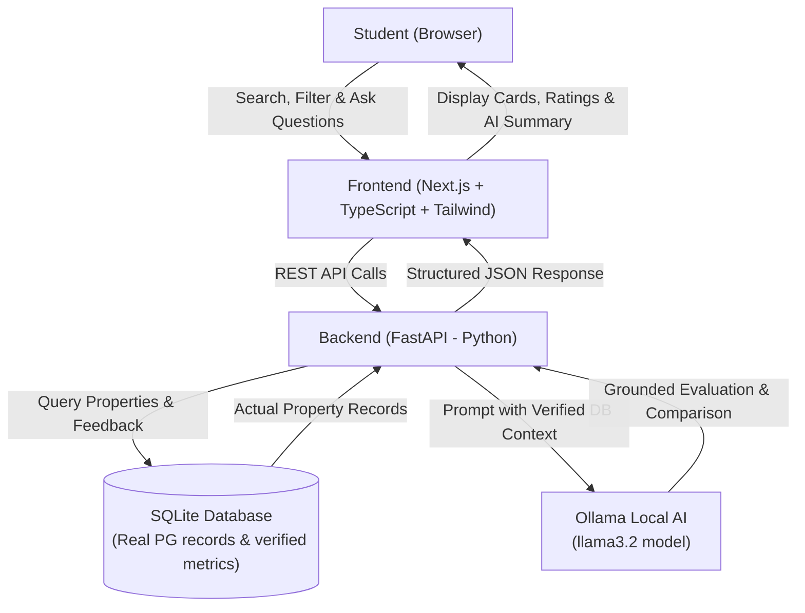

# PG Finder AI 🏠🤖

> An AI-powered search, verification, and comparison assistant that helps students find trustworthy Paying Guest (PG) accommodations without falling for deceptive listings or fabricated reviews.

---

## 🎯 The Problem

Students moving to new cities struggle to find safe, comfortable, and affordable PG accommodations. Traditional listing platforms often suffer from:
- **Outdated or misleading photos** that hide poor building age and room maintenance.
- **Exaggerated food and cleanliness claims** that do not reflect day-to-day realities.
- **Unverified owner behavior and hidden rules** (curfews, surprise fee deductions).
- **Hard-to-parse resident feedback**, making it difficult to compare tradeoffs across multiple properties.

## 💡 The Solution

**PG Finder AI** combines a verified relational database of PG properties with local AI reasoning (powered by **Ollama**):
1. **Grounded AI Analysis**: AI queries and analyzes *actual* database records and verified resident parameters—never hallucinating or inventing listings.
2. **Transparent Tradeoff Comparison**: Students can compare properties side-by-side across key dimensions: cleanliness, food rating, building age, owner behavior, security, and affordability.
3. **Conversational Assistant**: Students can ask natural language questions (e.g., *"Which PG near North Campus has good Wi-Fi, strict security, and home-cooked food under ₹10,000?"*) and receive factual, cited recommendations.
4. **100% Local & Privacy-Preserving AI**: Powered by Ollama locally, requiring zero third-party cloud API keys or fees during hackathon evaluation.

---

## 🏗️ Architecture



---

## 🛠️ Technology Stack

| Component | Technology | Role |
| :--- | :--- | :--- |
| **Frontend** | Next.js, TypeScript, Tailwind CSS | Modern, responsive student UI for search and comparison |
| **Backend** | Python, FastAPI, Uvicorn | High-performance REST API handling business logic and AI orchestration |
| **AI Engine** | Ollama (`ollama` Python SDK, `llama3.2`) | Local LLM inference for grounded reasoning, summarizing, and comparisons |
| **Database** | SQLite (via SQLAlchemy / SQLModel) | Lightweight, zero-config local relational database for properties and reviews |
| **Version Control** | Git | Tracking incremental changes phase by phase |

---

## 📁 Project Structure

```text
PG-Finder-AI/
├── .gitignore               # Git ignore rules for Python, Node, SQLite, env
├── README.md                # Project documentation and architecture guide
│
├── backend/                 # Python FastAPI Backend
│   ├── app/
│   │   ├── __init__.py
│   │   ├── init.py
│   │   ├── main.py          # FastAPI application entrypoint & routes
│   │   ├── database.py      # SQLite connection & session management
│   │   ├── models.py        # SQLAlchemy PGListing model
│   │   ├── schemas.py       # Pydantic request & response schemas
│   │   ├── routers/
│   │   │   ├── __init__.py
│   │   │   └── pgs.py       # PG listing CRUD & search endpoints
│   │   └── services/
│   │       ├── __init__.py
│   │       ├── init.py
│   │       └── ollama_service.py # Official Ollama SDK wrapper & error handling
│   ├── pg_finder.db         # Local SQLite database (auto-created on startup)
│   ├── requirements.txt     # Python backend dependencies
│   ├── .env.example         # Environment variables template
│   └── .env                 # Local configuration
│
└── frontend/                # Next.js Frontend Web Application
    ├── src/
    │   ├── app/
    │   │   ├── globals.css  # Tailwind CSS styling and theme
    │   │   ├── layout.tsx   # Root layout and metadata
    │   │   └── page.tsx     # Main PG explorer and AI assistant dashboard
    │   ├── components/
    │   │   ├── Navbar.tsx   # Header with branding and live API health status
    │   │   ├── HeroSection.tsx # Student search hero with quick city tags
    │   │   ├── FilterBar.tsx # Dynamic filters (budget, room type, amenities)
    │   │   ├── PGCard.tsx   # Accommodation card with verification badges
    │   │   ├── PGModal.tsx  # Detailed accommodation popup dialog
    │   │   ├── AIChatSection.tsx # Ollama AI chat assistant with suggested prompts
    │   │   ├── EmptyState.tsx # Friendly empty search results state
    │   │   └── Footer.tsx   # Project disclaimer & architecture info
    │   ├── lib/
    │   │   └── api.ts       # Fetch client communicating with FastAPI
    │   └── types/
    │       └── pg.ts        # TypeScript schemas matching backend Pydantic models
    ├── .env.example         # Environment template (NEXT_PUBLIC_API_BASE_URL)
    ├── .env.local           # Local configuration
    ├── package.json
    └── tsconfig.json
```

---

## 🚦 Phased Development Plan

To ensure a stable, beginner-friendly, and verifiable build, development is broken down into 6 discrete phases:

### Phase 1: Environment Inspection & Project Blueprint (Completed)
- [x] Inspect existing local tools (Python, Node, Git, Ollama).
- [x] Create project documentation, `.gitignore`, and folder skeleton.
- [x] Define architecture, schema outline, and verification strategy.

### Phase 2: Python Backend & Ollama Connection (Completed)
- [x] Create Python backend structure (`app/main.py`, `services/ollama_service.py`, `requirements.txt`, `.env.example`).
- [x] Set up Python virtual environment (`.venv`) and install minimal dependencies (`fastapi`, `uvicorn`, `pydantic`, `ollama`, `python-dotenv`).
- [x] Configure FastAPI application with CORS support for local frontend origin.
- [x] Implement `GET /health` endpoint verifying backend status and Ollama availability.
- [x] Connect local Ollama instance (`llama3.2:3b`) via official Python `ollama` SDK.
- [x] Implement `POST /api/ai/chat` endpoint with input validation and graceful error handling.

### Phase 3: SQLite Database & PG Listing API (Completed)
- [x] Add `sqlalchemy` to `requirements.txt` and install into `.venv`.
- [x] Configure SQLite connection and per-request session dependency (`app/database.py`).
- [x] Define `PGListing` SQLAlchemy model with all student accommodation fields (`app/models.py`).
- [x] Define Pydantic request and response schemas with input validation (`app/schemas.py`).
- [x] Implement CRUD & Search endpoints (`GET /api/pgs`, `GET /api/pgs/search`, `GET /api/pgs/{pg_id}`, `POST /api/pgs`).
- [x] Auto-create SQLite database tables on server startup with clearly marked fictional `[DEMO]` seed data.
- [x] Preserve existing `/health` (now reporting database health) and `/api/ai/chat` Ollama endpoint.

### Phase 4: Frontend Website & Accommodation Explorer (Completed)
- [x] Scaffold Next.js application with TypeScript and Tailwind CSS in `frontend/`.
- [x] Create API client (`src/lib/api.ts`) connecting to FastAPI endpoints (`http://127.0.0.1:8000`).
- [x] Build Header with live backend and Ollama connectivity status.
- [x] Build Hero search section with city and max budget filters.
- [x] Build interactive Filter Bar with real-time room type and amenity chips.
- [x] Build PG Cards and Details Modal displaying verified metrics and honest pricing.
- [x] Integrate interactive Ollama AI chat assistant panel with suggested student prompts.
- [x] Verify zero build/TypeScript errors (`npm run build`).

### Phase 5: Grounded Comparison & Advanced Tradeoff Analysis (Upcoming)
- [ ] Side-by-side accommodation comparison view.
- [ ] Strict database-prompt grounding for structured AI pros/cons breakdowns.

### Phase 6: Local Demo Hardening & Polish
- [ ] End-to-end demo scripts and verification for hackathon submission.

---

## 🚀 Quickstart Guide (Windows)

Follow these beginner-friendly steps to run and test the Python FastAPI backend on Windows.

### Step 1: Open Terminal and Navigate to Backend

Open **PowerShell** or **Command Prompt (CMD)** and navigate to the `backend/` directory:

```powershell
cd "c:\Users\ARP INFOTECH\Desktop\PG finder -Ai\backend"
```

### Step 2: Activate the Virtual Environment

**In PowerShell:**
```powershell
.\.venv\Scripts\Activate.ps1
```
*(Note: If PowerShell shows an `Execution_Policies` restriction, run `Set-ExecutionPolicy -ExecutionPolicy RemoteSigned -Scope Process` first, or activate via CMD).*

**In Command Prompt (CMD):**
```cmd
.\.venv\Scripts\activate.bat
```

When activated, you will see `(.venv)` at the beginning of your terminal prompt.

### Step 3: Install Dependencies

```powershell
python -m pip install -r requirements.txt
```

### Step 4: Verify Ollama is Running

Make sure Ollama is running and has the `llama3.2:3b` model downloaded:

```powershell
ollama list
```

### Step 5: Start the FastAPI Server

Launch the Uvicorn development server:

```powershell
python -m uvicorn app.main:app --reload --host 127.0.0.1 --port 8000
```

On startup, FastAPI automatically initializes `pg_finder.db` with SQLite tables and seeds initial fictional `[DEMO]` listings if empty.

---

## 🧪 Testing the Endpoints

### 1. Test Health Endpoint (`GET /health`)

Shows the status of the server, SQLite database, and Ollama model:

```powershell
Invoke-RestMethod -Uri "http://127.0.0.1:8000/health" -Method GET | ConvertTo-Json
```

**Expected JSON Response:**
```json
{
  "status": "healthy",
  "service": "PG Finder AI API",
  "version": "1.0.0",
  "database": {
    "connected": true,
    "engine": "sqlite",
    "database_url": "./pg_finder.db"
  },
  "ollama": {
    "connected": true,
    "host": "http://localhost:11434",
    "model": "llama3.2:3b",
    "model_available": true
  }
}
```

---

### 2. List All PG Accommodations (`GET /api/pgs`)

```powershell
Invoke-RestMethod -Uri "http://127.0.0.1:8000/api/pgs" -Method GET | ConvertTo-Json -Depth 3
```

---

### 3. Search and Filter PGs (`GET /api/pgs/search`)

Filter by city, max monthly rent, room type, and amenities:

**Filter by City and Max Budget:**
```powershell
Invoke-RestMethod -Uri "http://127.0.0.1:8000/api/pgs/search?city=Demo&max_rent=10000" -Method GET | ConvertTo-Json -Depth 3
```

**Filter by Room Type and Wi-Fi:**
```powershell
Invoke-RestMethod -Uri "http://127.0.0.1:8000/api/pgs/search?room_type=single&wifi_available=true" -Method GET | ConvertTo-Json -Depth 3
```

**Filter by Food and Attached Bathroom:**
```powershell
Invoke-RestMethod -Uri "http://127.0.0.1:8000/api/pgs/search?food_available=true&attached_bathroom=true" -Method GET | ConvertTo-Json -Depth 3
```

---

### 4. Get a Single PG by ID (`GET /api/pgs/{pg_id}`)

```powershell
Invoke-RestMethod -Uri "http://127.0.0.1:8000/api/pgs/1" -Method GET | ConvertTo-Json -Depth 3
```

**Test 404 on Missing ID:**
```powershell
try {
  Invoke-RestMethod -Uri "http://127.0.0.1:8000/api/pgs/99999" -Method GET
} catch {
  $_.Exception.Response.StatusCode
  $_.ErrorDetails.Message
}
```

---

### 5. Create a New PG Listing (`POST /api/pgs`)

```powershell
$newPg = @{
  name = "[DEMO] Fictional Campus Heights PG"
  city = "Demo City"
  locality = "Engineering College Road"
  full_address = "78 Scholar Boulevard, Demo City"
  monthly_rent = 7800.0
  security_deposit = 7800.0
  room_type = "double-sharing"
  food_available = $true
  wifi_available = $true
  laundry_available = $true
  attached_bathroom = $true
  building_age_years = 2
  description = "[DEMO] Fictional modern student PG with power backup, CCTV, and 3 daily meals."
  verification_status = "verified"
} | ConvertTo-Json

Invoke-RestMethod -Uri "http://127.0.0.1:8000/api/pgs" -Method POST -ContentType "application/json" -Body $newPg | ConvertTo-Json -Depth 3
```

---

### 6. Test AI Chat Endpoint (`POST /api/ai/chat`)

Verify that the local Ollama connection remains active:

```powershell
$body = @{ message = "What questions should I ask a PG owner about electricity charges and curfew?" } | ConvertTo-Json
Invoke-RestMethod -Uri "http://127.0.0.1:8000/api/ai/chat" -Method POST -ContentType "application/json" -Body $body | ConvertTo-Json
```

---

### 7. Interactive Swagger UI

Open [http://127.0.0.1:8000/docs](http://127.0.0.1:8000/docs) in your browser to interactively test all PG listing and AI endpoints.

---

## 💻 Hackathon Requirements Checklist

| Requirement | Implementation Detail | Status |
| :--- | :--- | :---: |
| **Python Backend** | FastAPI + Uvicorn | Completed (Phase 2) |
| **Local Ollama AI** | Official `ollama` Python library (`llama3.2:3b`) | Verified & Tested |
| **Database Layer** | SQLite + SQLAlchemy ORM (`backend/pg_finder.db`) | Completed (Phase 3) |
| **PG Listing Model** | 16 fields covering amenities, rent, rooms, verification | Completed (Phase 3) |
| **PG Listing API** | `GET /api/pgs`, `GET /api/pgs/{id}`, `POST /api/pgs`, `GET /api/pgs/search` | Completed (Phase 3) |
| **Automatic Tables** | Tables created on FastAPI startup via Lifespan | Completed (Phase 3) |
| **No Fabricated Real Data** | Only clearly marked `[DEMO]` fictional listings used | Followed |
| **Frontend Connection** | Next.js calling FastAPI REST API | Planned (Phase 5) |
| **Grounded AI** | AI prompts bound to SQLite retrieved rows | Planned (Phase 4) |
| **Easy Local Demo** | Runs on `127.0.0.1:8000` with 0 external API keys | Ready |


