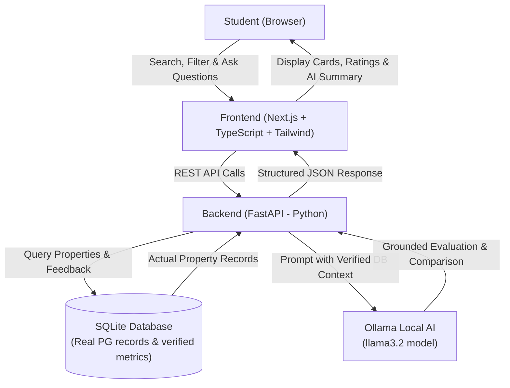

# PG Finder AI 🏠🤖

> An AI-powered search, verification, and comparison assistant that helps students find trustworthy Paying Guest (PG) accommodations without falling for deceptive listings or fabricated reviews.

---

## 🎯 The Problem

Students moving to new cities struggle to find safe, comfortable, and affordable PG accommodations. Traditional listing platforms often suffer from:
- **Outdated or misleading photos** that hide poor building age and room maintenance.
- **Exaggerated food and cleanliness claims** that do not reflect day-to-day realities.
- **Unverified owner behavior and hidden rules** (curfews, surprise fee deductions).
- **Hard-to-parse resident feedback**, making it difficult to compare tradeoffs across multiple properties.

## 💡 The Solution

**PG Finder AI** combines a verified relational database of PG properties with local AI reasoning (powered by **Ollama**):
1. **Grounded AI Analysis**: AI queries and analyzes *actual* database records and verified resident parameters—never hallucinating or inventing listings.
2. **Transparent Tradeoff Comparison**: Students can compare properties side-by-side across key dimensions: cleanliness, food rating, building age, owner behavior, security, and affordability.
3. **Conversational Assistant**: Students can ask natural language questions (e.g., *"Which PG near North Campus has good Wi-Fi, strict security, and home-cooked food under ₹10,000?"*) and receive factual, cited recommendations.
4. **100% Local & Privacy-Preserving AI**: Powered by Ollama locally, requiring zero third-party cloud API keys or fees during hackathon evaluation.

---

## 🏗️ Architecture



---

## 🛠️ Technology Stack

| Component | Technology | Role |
| :--- | :--- | :--- |
| **Frontend** | Next.js, TypeScript, Tailwind CSS | Modern, responsive student UI for search and comparison |
| **Backend** | Python, FastAPI, Uvicorn | High-performance REST API handling business logic and AI orchestration |
| **AI Engine** | Ollama (`ollama` Python SDK, `llama3.2`) | Local LLM inference for grounded reasoning, summarizing, and comparisons |
| **Database** | SQLite (via SQLAlchemy / SQLModel) | Lightweight, zero-config local relational database for properties and reviews |
| **Version Control** | Git | Tracking incremental changes phase by phase |

---

## 📁 Project Structure

```text
PG-Finder-AI/
├── .gitignore               # Git ignore rules for Python, Node, SQLite, env
├── README.md                # Project documentation and architecture guide
│
├── backend/                 # Python FastAPI Backend
│   ├── app/
│   │   ├── __init__.py
│   │   ├── main.py          # FastAPI application entrypoint & routes
│   │   ├── config.py        # Settings and environment variables
│   │   ├── database.py      # SQLite connection & session management
│   │   ├── models.py        # SQLAlchemy / SQLModel schema definitions
│   │   ├── schemas.py       # Pydantic request/response models
│   │   ├── seed.py          # Sample seed data with authentic PG parameters
│   │   └── ai/
│   │       ├── __init__.py
│   │       ├── ollama_client.py # Ollama Python wrapper & health checks
│   │       └── prompt_templates.py # Grounded prompt engineering
│   ├── tests/               # Backend verification tests
│   └── requirements.txt     # Python backend dependencies
│
└── frontend/                # Next.js Frontend (to be built in later phase)
    ├── src/
    │   ├── app/             # Next.js App Router pages
    │   ├── components/      # UI components (PGCard, ComparisonTable, AIChat)
    │   └── lib/             # API client & utilities
    ├── package.json
    └── tailwind.config.js
```

---

## 🚦 Phased Development Plan

To ensure a stable, beginner-friendly, and verifiable build, development is broken down into 6 discrete phases:

### Phase 1: Environment Inspection & Project Blueprint (Current)
- [x] Inspect existing local tools (Python, Node, Git, Ollama).
- [x] Create project documentation, `.gitignore`, and folder skeleton.
- [x] Define architecture, schema outline, and verification strategy.

### Phase 2: Backend Setup & Database Grounding
- [ ] Set up Python virtual environment (`.venv`) and install `fastapi`, `uvicorn`, `sqlalchemy`, and `ollama`.
- [ ] Define SQLite database models:
  - `PGProperty`: Name, address, city, rent, room types, building age, deposit, amenities.
  - `PGScorecard`: Cleanliness rating, food quality rating, owner behavior score, curfew/rules.
  - `VerifiedReview`: Authentic student testimonials tagged by category.
- [ ] Create seed script (`seed.py`) with realistic, diverse PG listings.
- [ ] Implement CRUD endpoints (`GET /properties`, `GET /properties/{id}`).

### Phase 3: Ollama AI Integration & Grounded Evaluation
- [ ] Connect FastAPI to local Ollama instance (`llama3.2`) via the official `ollama` Python client.
- [ ] Implement strict ground-truth prompt template:
  - Enforce that recommendations cite actual database fields.
  - Prevent hallucination of non-existent accommodations.
- [ ] Build AI endpoints:
  - `POST /ai/evaluate`: Evaluates a single PG's pros, cons, and student-fit.
  - `POST /ai/compare`: Compares 2-3 PGs side-by-side based on student priorities.
  - `POST /ai/search`: Natural-language search converted into filtered property recommendations.

### Phase 4: Frontend Scaffolding & Property Explorer
- [ ] Initialize Next.js project with TypeScript and Tailwind CSS in `frontend/`.
- [ ] Create property listing dashboard with responsive search and filter controls (rent range, food, cleanliness, gender, curfews).
- [ ] Build detailed property card displaying verified metrics and scores.

### Phase 5: AI-Driven Comparison & Assistant UI
- [ ] Build Side-by-Side Property Comparison view with AI tradeoff breakdown.
- [ ] Build an interactive AI Ask/Chat widget connected to `POST /ai/search` and `POST /ai/evaluate`.
- [ ] Add visual badges for metrics (e.g., "High Cleanliness", "Strict Rules", "Great Food").

### Phase 6: Local Demo Hardening & Polish
- [ ] Write end-to-end local startup guide (`run-backend.bat`, `run-frontend.bat`).
- [ ] Test edge cases (Ollama server down graceful fallback, empty database, search not found).
- [ ] Prepare demo walkthrough script for hackathon judges.

---

## 💻 Hackathon Requirements Checklist

| Requirement | Implementation Detail | Status |
| :--- | :--- | :---: |
| **Python Backend** | FastAPI + Uvicorn | Ready to initialize |
| **Local Ollama AI** | Official `ollama` Python library (`llama3.2`) | Ollama verified running locally |
| **Frontend Connection** | Next.js calling FastAPI REST API | Planned (Phase 4-5) |
| **No Invented Properties** | AI prompts strictly bound to SQLite retrieved rows | Planned (Phase 3) |
| **Easy Local Demo** | Runs on `localhost:8000` & `localhost:3000` with 0 external API keys | Ready |
